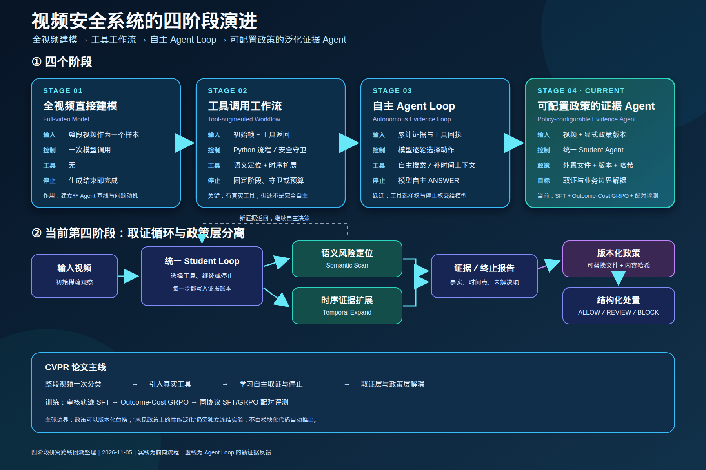

# Adaptive Video Evidence Agent

[中文说明](README.zh-CN.md)

This repository preserves the four-stage evolution of a video-safety system:
from treating each full video as a single model sample, to a policy-configurable
evidence Agent that can acquire evidence and decide when to stop.

## Four-stage organization

| Stage | Mode | Who controls observation and stopping? | Main role |
|---|---|---|---|
| [01](stages/01_full_video_model/) | Full-video model | One model call; generation ends the run | Non-Agent baseline |
| [02](stages/02_tool_workflow/) | Tool workflow | Python workflow and safety guards | Establish real semantic/temporal tools |
| [03](stages/03_autonomous_agent_loop/) | Autonomous Agent loop | Model chooses tool, continuation, or stop | Learn active evidence acquisition |
| [04](stages/04_policy_configurable_agent/) | Policy-configurable Agent | Unified Student loop plus external versioned policy | Current research line |

The four folders are the reader-facing entry points. Shared implementations
remain under `video_detection_agent/` so frame extraction, tools, replay,
training, and evaluation code are not copied into four drifting versions.
Historical stage entrypoints are preserved inside their stage folders.

See [the stage comparison](stages/README.md) and the
[Chinese four-stage roadmap](docs/figures/four_stage_roadmap_zh.png).

The editable vector version is available as
[SVG](docs/figures/four_stage_roadmap_zh.svg).

## Current stage

Stage 04 uses one Student to choose semantic scan, temporal expansion, or a
terminal report. Policies are external versioned files with recorded hashes,
so policy changes do not silently rewrite a frozen experiment. The repository
supports policy configuration structurally; empirical generalization to a new
policy must still be evaluated independently.

The current SFT and 53-step outcome-cost GRPO candidate are compared with
frozen, paired runtime bindings on 1,915 Dev and 1,924 Test videos.

## Preservation boundary

This is a curated experiment record, not a mirror of the former
MM-EUREKA-Qwen workspace. Model weights, videos, datasets, caches, bulk
rollouts, and optimizer states remain outside Git. The repository keeps source,
small authoritative reports, frozen run configurations, manifests, and hashes.

The Git history was reconstructed on 2026-11-05 from real frozen records. It
organizes the four stages but does not pretend that Git commits existed on the
original experiment dates.

