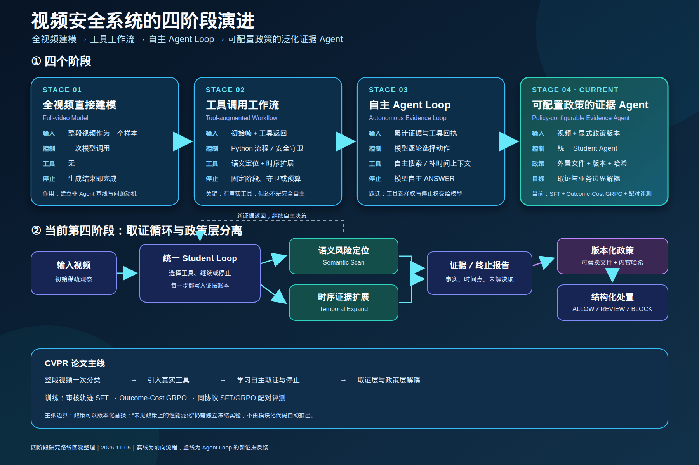

# 自适应视频证据 Agent

[English](README.md)

本仓库保存视频安全系统的四阶段发展过程：从把完整视频当作单个样本直接输入模型，逐步发展到能够主动获取证据、自主停止，并通过外部版本化政策调整判定边界的证据 Agent。

## 四阶段路线图



论文排版或继续修改时可使用[矢量 SVG 版本](docs/figures/four_stage_roadmap_zh.svg)。

| 阶段 | 模式 | 谁控制观察与停止 | 论文中的作用 |
|---|---|---|---|
| [01](stages/01_full_video_model/) | 全视频直接建模 | 一次模型调用；生成结束即任务结束 | 非 Agent 基线与研究动机 |
| [02](stages/02_tool_workflow/) | 工具调用工作流 | Python 工作流和安全守卫主导 | 建立真实的语义、时序工具 |
| [03](stages/03_autonomous_agent_loop/) | 自主 Agent Loop | 模型决定调用工具、继续观察或停止 | 主动取证与自主停止 |
| [04](stages/04_policy_configurable_agent/) | 可配置政策的证据 Agent | 统一 Student Loop 配合外部版本化政策 | 当前研究主线 |

四个阶段目录是面向读者的入口。共享实现继续保留在 `video_detection_agent/`，避免把抽帧、工具、回放、训练与评测代码复制成四套并逐渐产生差异。历史阶段的关键入口脚本则保存在对应阶段目录中。

## 论文故事线

第一阶段验证了全视频端到端建模的基本能力，但模型只能被动接收固定输入，无法解释证据从何而来，也不能主动补充观察。

第二阶段引入语义扫描和时序扩展工具，系统开始具备分步取证能力；不过工具顺序和停止条件主要由固定工作流控制，因此“有工具调用”还不等于 Agent 自主决策。

第三阶段将工具选择、继续观察和停止交给模型，在多轮累积证据的过程中形成自主 Agent Loop。这里的核心变化是从固定流程转向由模型控制的主动感知。

第四阶段进一步把安全政策从 Agent 的固定提示和输出逻辑中拆出，使用外部、版本化并记录哈希的政策文件。统一 Student 负责证据获取和停止，政策负责把证据映射为最终处置，从而形成当前面向泛化的证据 Agent。

这条主线可以概括为：

```text
全视频被动预测
  -> 固定工具工作流
      -> 自主取证与停止
          -> 证据 Agent 与政策解耦
```

## 当前阶段与结论边界

阶段 04 中，一个 Student 可以选择语义扫描、时序扩展或提交终止报告。每次实验记录政策版本及哈希，防止政策变化悄悄改写冻结实验。

仓库已经在结构上实现政策可配置和可替换，但“同一个冻结模型能泛化到任意未见政策”仍然是需要通过独立跨政策实验验证的经验性结论，不能仅由代码模块化推出。

当前 SFT 与 53 步 outcome-cost GRPO 候选模型采用冻结、配对的运行时绑定，在 1,915 个 Dev 视频和 1,924 个 Test 视频上比较。

## 仓库组织

```text
stages/
  01_full_video_model/           全视频直接建模
  02_tool_workflow/              工具调用工作流
  03_autonomous_agent_loop/      自主 Agent Loop
  04_policy_configurable_agent/  可配置政策的证据 Agent
video_detection_agent/           当前共享的正式实现
docs/agent_versions/             历史版本与产物清单
docs/figures/                    路线图 PNG/SVG
```

更详细的阶段对比见 [`stages/README.md`](stages/README.md)，历史版本、冻结产物及 Git 保存原则见 [`docs/agent_versions/README.md`](docs/agent_versions/README.md)。

## 保存范围

这是整理后的实验记录，而不是原 `MM-EUREKA-Qwen` 工作区的完整镜像。模型权重、视频、数据集、缓存、大批量 rollout 和优化器状态不进入 Git；仓库保存源代码、小型权威报告、冻结运行配置、清单与哈希。

Git 历史于 2026 年 11 月 5 日根据真实冻结记录回溯整理，用来表达四个研究阶段，但不声称这些提交在原始实验日期就已经存在。
